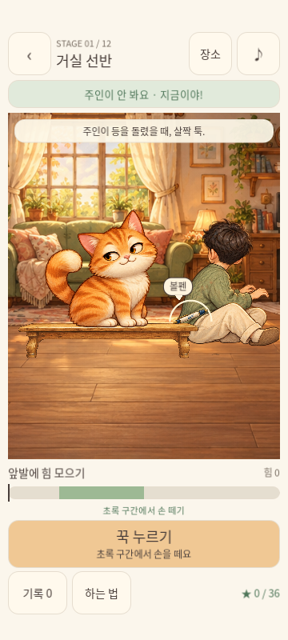
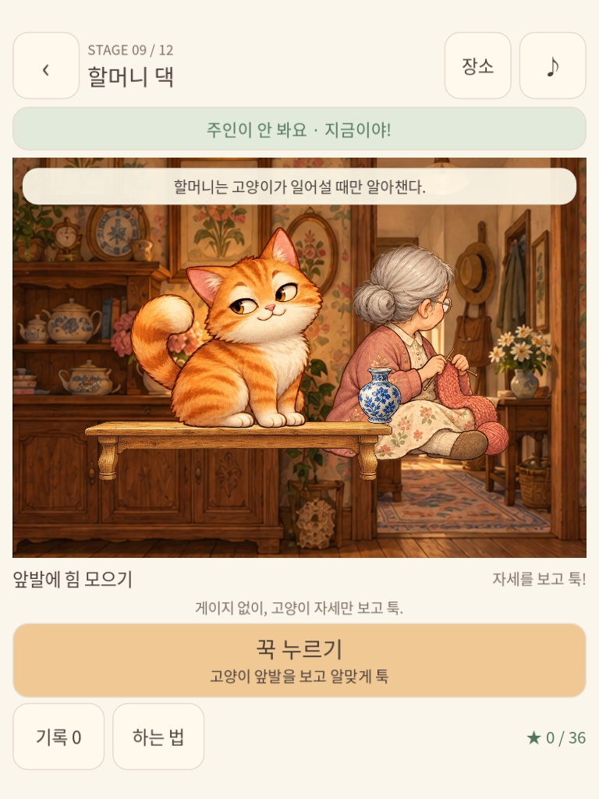
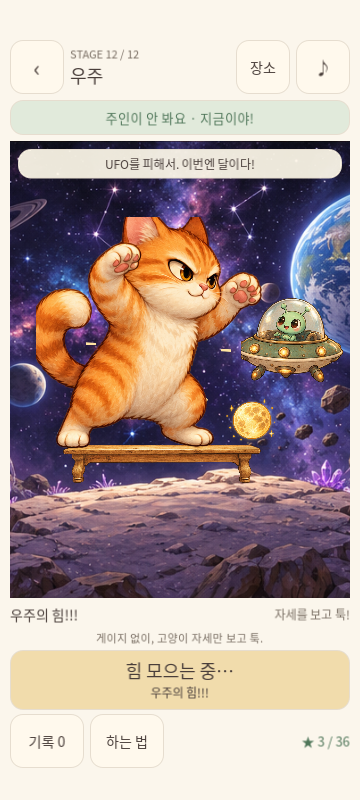

# 툭 · TUK Android 테스트 APK

버전: 0.3.0-dev · Android 7.0(API 24) 이상 · ARM 32/64비트

[TUK-debug.apk 다운로드](https://github.com/leehaeillee/took/raw/refs/tags/apk-v0.3.0/TUK-debug.apk)

휴대폰에서 APK를 내려받아 열고, 요청되면 파일을 연 앱의 “알 수 없는 앱 설치”를 허용합니다. 이전 빌드와 같은 키를 사용해 기존 앱 위에 업데이트할 수 있습니다.

## 0.3.0 변경

- 작은 휴대폰·긴 화면·태블릿에 맞춰 HUD, 장면, 터치 영역, 홈과 결과창을 Container 레이아웃으로 재구성했습니다.
- Android 안전 영역을 반영하고 실제 표시 위치에 맞춰 터치를 판정합니다. 메뉴는 스크롤되며 닫기 버튼은 화면 안에 남습니다.
- 고양이 6개 자세, 배경 12개, 물건 12개, 감시자·받침대·앱 아이콘을 새 일러스트로 교체했습니다. 이미지는 생성형 도구로 제작했으며 몇몇 장소의 사람 감시자는 공통 그림을 사용합니다.
- 배경은 영역을 채우고 캐릭터는 비율을 유지합니다. 거대 고양이 스테이지는 귀와 꼬리가 잘리지 않도록 별도로 프레이밍합니다.
- 12개 장소의 힘 범위와 감시자 규칙, 별·진행 저장은 유지합니다.

## 실제 게임 화면

휴대폰 비율(360×800):

태블릿(768×1024):

마지막 장소·강한 힘:

## 검증 및 범위

Godot 엔진과 실제 OpenGL 화면에서 각각 640개 검사를 통과했습니다. 320×568부터 768×1024까지의 휴대폰/태블릿과 추가 가로 창 크기, 모의 노치·제스처 여백, 실제 입력 이벤트, 결과 재도전 및 게임 규칙을 검사했습니다. 내보낸 APK 리소스에서도 시작 화면과 12개 라운드를 확인했습니다. APK 서명·ZIP 무결성·16KiB 정렬을 확인했습니다.

클라우드 에뮬레이터는 하드웨어 가속 없이 부팅을 완료하지 못했습니다. 실제 Android 휴대폰의 화면 안전 영역·터치·성능은 별도 확인이 필요합니다. 위 화면은 실제 데스크톱 Godot 렌더링이며 휴대폰 촬영 화면이 아닙니다.

현재 초기 프로토타입으로 광고·결제·사진 앨범·스킨 해금은 미구현입니다. 스토어용 서명이 아닌 테스트용 디버그 서명입니다. 인터넷 권한을 포함하지 않으며 짧은 진동을 위한 VIBRATE 권한만 포함합니다.

SHA-256은 SHA256SUMS에 있습니다. 엔진 MIT 라이선스, 서드파티 고지 및 폰트 SIL OFL을 동봉합니다. 게임 소스 코드는 이 브랜치에 포함하지 않습니다.
